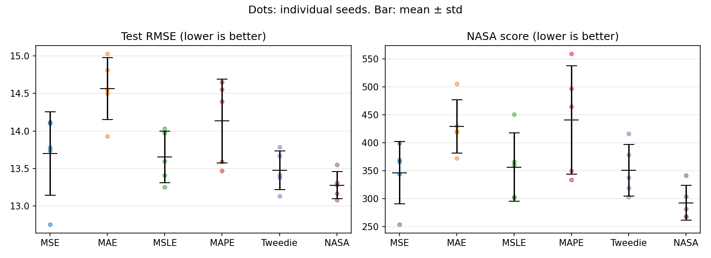
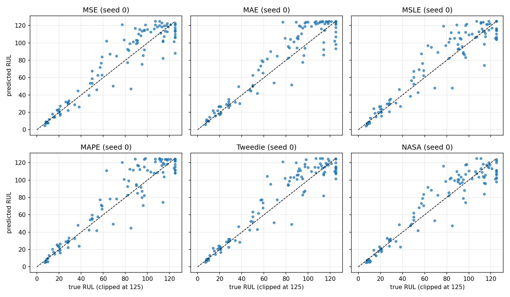
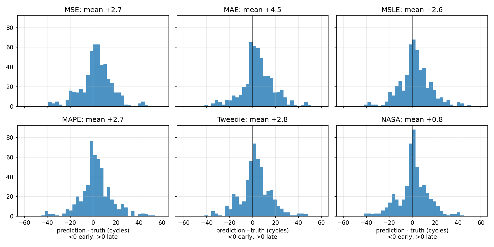

# turbofan-rul-loss-comparison

Predicting the Remaining Useful Life (RUL) of turbofan engines from sensor data, and comparing how different loss functions change what an LSTM learns.

Built as an applied project for the NPTEL course *Machine Learning for Core Engineering Disciplines* (IISc Bangalore, Jul–Oct 2026).

## Summary

- Task: predict RUL at the last recorded cycle of each of the 100 test engines in NASA C-MAPSS **FD001**.
- Every LSTM variant beats the classical baselines (Ridge, Random Forest).
- Six loss functions were compared with the same model, optimizer, split and epochs, over **5 seeds**.
- **MAE and MAPE are the weakest losses.** MSE, MSLE, Tweedie and the asymmetric NASA loss are close, with the NASA loss best on average on every metric and the least late-biased. That edge is suggestive, not statistically established (see [Findings and limitations](#findings-and-limitations)).
- A cross-entropy variant ("fails within 30 cycles?") is also included.

## Dataset

NASA C-MAPSS turbofan degradation dataset, subset FD001 (100 training engines run to failure, 100 test engines cut off before failure, one operating condition, one fault mode). Download it from the NASA Prognostics Data Repository and place `train_FD001.txt`, `test_FD001.txt` and `RUL_FD001.txt` in `data/` (the folder is not tracked by Git).

## Method

- **Target:** training RUL = last cycle of the engine minus the current cycle, clipped at 125 (early-life degradation is essentially undetectable). Test targets are clipped at 125 too, so numbers are **not directly comparable** with papers that evaluate against unclipped RUL.
- **Features:** 17 sensors/settings left after dropping the constant ones; MinMax scaling fit on the training set only.
- **Windows:** 30-cycle sliding windows, labelled with the RUL at the window's last cycle. The test input is the last window of each test engine.
- **Model:** 2-layer LSTM (64 hidden units, dropout 0.2) with a linear head on the last time step; the output is shifted and scaled so training starts near the typical RUL.
- **Training:** Adam (lr 1e-3), batch size 256, 60 epochs. 20 training engines are held out (split by engine, not by row) and used only to pick the best epoch by validation RMSE. The same procedure is used for every loss.
- **Seeds:** 5 seeds (0–4). A seed fixes the initial weights and the shuffling, so each seed starts all six losses from the same weights and runs are reproducible.
- **Evaluation:** RMSE, MAE, the C-MAPSS asymmetric score (late predictions cost more than early ones), and mean signed error (prediction − truth; positive = late). Predictions are clipped to [0, 125] for every loss.

## Results

Classical baselines (single run, same test protocol): **Ridge RMSE 20.8**, **Random Forest RMSE 17.0**.

LSTM with six losses, mean ± std over 5 seeds (test set: last window of each of the 100 engines, RUL clipped at 125):

| Loss | RMSE | MAE | NASA score | Mean signed error |
|---|---|---|---|---|
| MSE | 13.70 ± 0.56 | 10.26 ± 0.60 | 347 ± 56 | +2.7 |
| MAE | 14.56 ± 0.41 | 10.70 ± 0.47 | 430 ± 48 | +4.5 |
| MSLE | 13.65 ± 0.34 | 10.05 ± 0.21 | 357 ± 61 | +2.6 |
| MAPE | 14.13 ± 0.56 | 10.02 ± 0.35 | 441 ± 97 | +2.7 |
| Tweedie (p = 1.5) | 13.48 ± 0.26 | 9.93 ± 0.18 | 351 ± 46 | +2.8 |
| NASA (asymmetric) | **13.28 ± 0.18** | **9.57 ± 0.27** | **293 ± 31** | **+0.8** |

The exact table generated from the saved runs is in `results/summary_table.md`, and the per-run data is in `results/runs.csv`.



Predicted vs true RUL for seed 0 (all models are accurate close to failure and spread out far from it, where degradation is hard to see):



Signed error pooled over the 5 seeds (<0 early, >0 late). Note that the same 100 test engines appear in every seed, so the pooled points are not independent:



### Cross-entropy variant

The question is changed to "will the engine fail within 30 cycles?" (25 of the 100 test engines are within 30 cycles of failure). An LSTM trained with binary cross-entropy is compared with the regression models used as classifiers (predicted RUL ≤ 30). Mean over 5 seeds:

| Approach | Accuracy | F1 | AUC |
|---|---|---|---|
| BCE classifier | 0.962 | 0.921 | 0.996 |
| Regression: MSE | 0.944 | 0.881 | 0.995 |
| Regression: MAE | 0.966 | 0.930 | 0.996 |
| Regression: MSLE | 0.962 | 0.922 | 0.996 |
| Regression: MAPE | 0.976 | 0.952 | 0.996 |
| Regression: Tweedie | 0.960 | 0.917 | 0.996 |
| Regression: NASA | 0.952 | 0.901 | 0.995 |

AUC is about 0.995 for every approach, and the accuracy differences amount to a few engines out of 100, so the classification loss gave no clear advantage over thresholding a regression model.

## Loss functions and their statistical basis

| Loss | Statistical idea | Behaviour to expect |
|---|---|---|
| MSE | Maximum likelihood under Gaussian noise with constant variance; estimates the conditional mean | Penalises large errors heavily, so it is sensitive to outliers |
| MAE | Maximum likelihood under Laplace noise; estimates the conditional median | Robust to outliers, but its constant-size gradient can make convergence noisier near the optimum |
| MSLE | Squared error on log(1 + y), i.e. multiplicative (roughly log-normal) noise; output passed through softplus to stay non-negative | Judges relative error, so a given absolute miss costs more at small RUL |
| MAPE | Absolute error divided by the true value; no standard noise model behind it (denominator clamped at 1 here) | Weights errors at small RUL very heavily and is unstable as RUL approaches 0 |
| Tweedie (p = 1.5) | Deviance of a Tweedie distribution for non-negative, right-skewed targets whose variance grows with the mean; output passed through softplus | Matches the skew of the RUL data; p interpolates between Poisson (1) and Gamma (2) |
| Asymmetric (NASA) | Not a likelihood but a cost function: the C-MAPSS scoring rule with exponential penalties, larger for late predictions (prediction above truth) than early ones; error clamped to ±50 for stability | Pushes predictions earlier, which matches the maintenance cost: a late prediction risks a failure |
| Binary cross-entropy | Bernoulli likelihood for "fails within 30 cycles?" | Classification variant, evaluated with accuracy, F1 and AUC |

## Findings and limitations

What the results support:

- All LSTM variants (RMSE 13.3 to 14.6) beat Random Forest (17.0) and Ridge (20.8).
- **MAE as a loss is the worst choice here**: higher RMSE than MSE in all 5 seeds and the largest late bias (+4.5).
- **MAPE is unstable**: its NASA score ranges from 334 to 559 across seeds.
- The asymmetric loss has the lowest late bias (about +0.8, against +2.6 to +2.8 for MSE, MSLE, MAPE and Tweedie), and its error histogram has a thinner late tail. This is consistent with the idea that penalising late predictions pushes the model earlier; the mechanism itself was not tested.

What is only suggestive:

- Compared seed by seed against MSE, the NASA loss had lower RMSE and lower NASA score in 4 of 5 seeds; Tweedie and MSLE had lower RMSE in 4 of 5 seeds. The exception in each case is seed 3, where MSE had an unusually good run (RMSE 12.76). With 5 seeds and one reversal, this is not statistically conclusive, and the differences among MSE, MSLE, Tweedie and the NASA loss are about the size of the seed-to-seed spread.

Limitations:

- One dataset subset (FD001) and one architecture; no hyperparameters were tuned per loss (for example the Tweedie power or the learning rate).
- The test set is 100 engines with one window each, so the test sample itself adds uncertainty that the seed spread does not capture.
- The NASA loss is evaluated partly on the metric it optimises, so its NASA-score advantage is expected; its gains in RMSE and MAE are the more informative result.
- Test targets are clipped at 125, so the numbers are not directly comparable with published results.
- In the classification comparison, the 0.5 probability threshold and the RUL ≤ 30 rule were not tuned, and there are only 25 positive engines.

## Reproduce

```bash
python -m venv .venv && source .venv/bin/activate
pip install -r requirements.txt
pip install -e .
# place train_FD001.txt, test_FD001.txt, RUL_FD001.txt in data/

python -m src.run_losses           # 6 losses x 5 seeds, about 50 min on CPU
python -m src.run_classification   # cross-entropy variant, about 8 min
python -m src.make_plots           # summary table and figures
```

`run_losses` saves after every run and skips finished runs, so it can be stopped and resumed.

## Repository layout

```
src/
  data.py                  loading, RUL target, scaling, windowing, prepare_data
  models.py                LSTM regressor
  losses.py                MSLE, MAPE, Tweedie, asymmetric NASA loss
  train.py                 training loop, metrics, seeding
  run_losses.py            loss comparison experiment
  run_classification.py    cross-entropy variant
  make_plots.py            summary table and figures
notebooks/                 exploration, baselines, first LSTM
results/                   runs.csv, preds/, classification.csv, summary_table.md, figures/
```